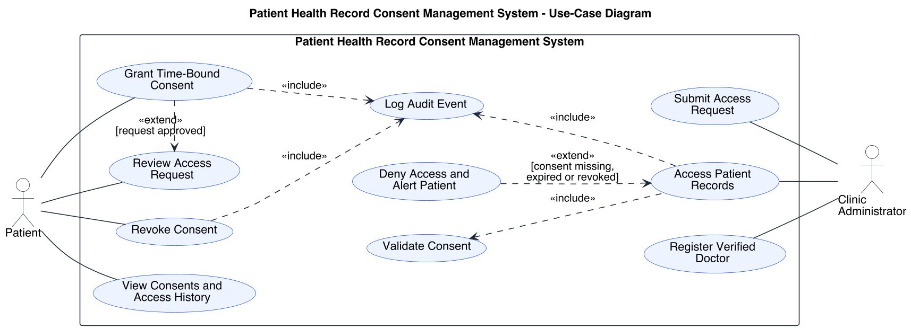

# Lab 1: Requirements Engineering & UML Use-Case Modelling

**Problem Statement #13:** Patient Health Record Consent Management System (Healthcare & Telemedicine)

**Name:** Mohammed Tahir Siddique | **SRN:** PES2UG24AM092

## Problem Overview

A patient-centric electronic health data gateway where patients explicitly manage granular, time-bound consent permissions for clinics, diagnostic labs and consulting doctors to access their medical history.

**Actors:** Patient, Clinic Administrator

## Deliverables

| # | Deliverable | Files |
|---|-------------|-------|
| 1 | Requirements Table (5 FRs + 2 NFRs) | [requirements.md](requirements.md), [requirements.pdf](requirements.pdf) |
| 2 | UML Use-Case Diagram | [use-case-diagram.png](use-case-diagram.png), [use-case-diagram.puml](use-case-diagram.puml) |
| 3 | Use-Case Flow Specification (UC-01: Grant Time-Bound Consent) | [use-case-specification.md](use-case-specification.md), [use-case-specification.pdf](use-case-specification.pdf) |

## UML Use-Case Diagram

### Relationships used

| Relationship | From | To | Meaning |
|--------------|------|----|---------|
| «include» | Access Patient Records | Validate Consent | Every record access must check for a valid consent. |
| «include» | Grant Time-Bound Consent, Revoke Consent, Access Patient Records | Log Audit Event | Each of these events is always written to the audit trail. |
| «extend» | Grant Time-Bound Consent | Review Access Request | A consent is granted only when the patient approves the request. |
| «extend» | Deny Access and Alert Patient | Access Patient Records | Runs only when the consent is missing, expired or revoked. |

The diagram is generated from [use-case-diagram.puml](use-case-diagram.puml) using PlantUML.
